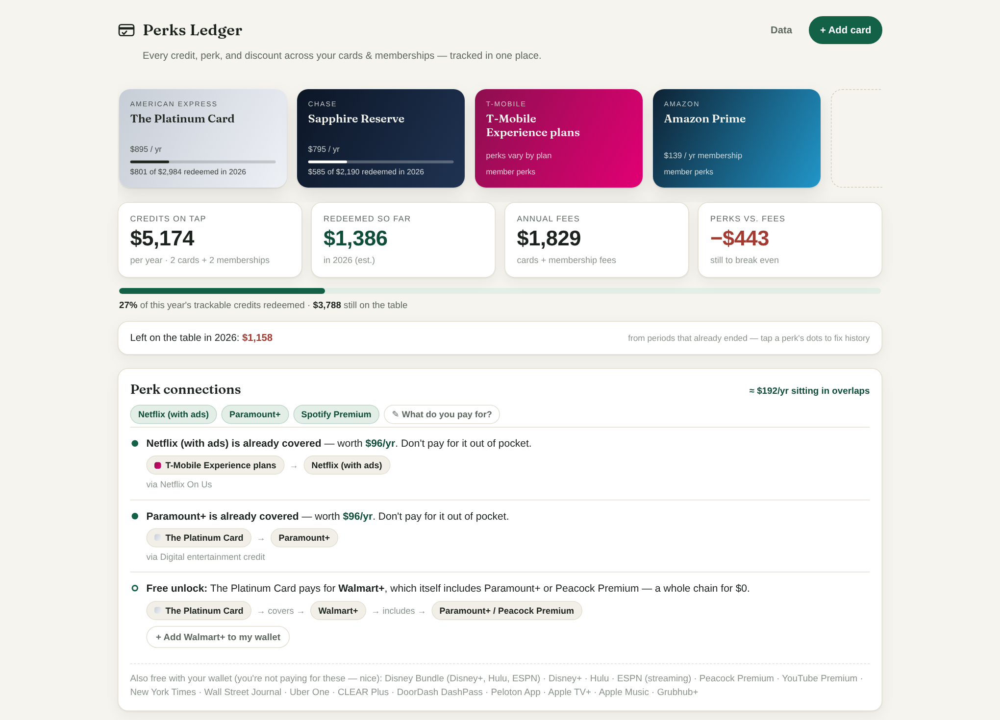
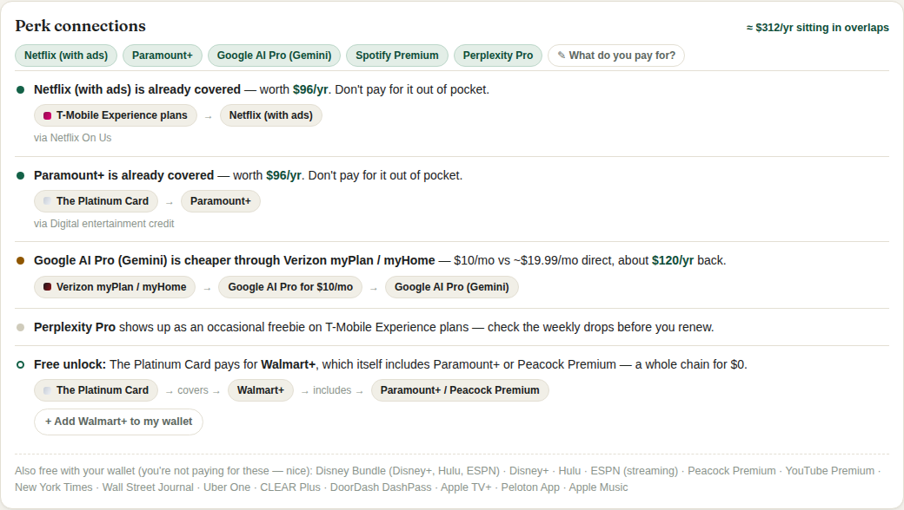

<div align="center">


# Perks Ledger

### Your cards pay you back. Make sure they actually do.

Every credit, perk, offer and welcome bonus across your credit cards and memberships, in one private checklist that knows when each one resets.

[](https://perksledger.vercel.app)

[](#-changelog)
[](#-keeping-the-data-honest)
[](index.html)
[](build-pwa.js)
[](#-privacy-by-architecture)

[Features](#-what-it-does) · [The Perk Graph](#-the-perk-graph) · [Install on your phone](#-install-it-in-10-seconds) · [How it's built](#-under-the-hood) · [Roadmap](#-roadmap)

<br>

<picture>
  <source media="(prefers-color-scheme: dark)" srcset=".github/assets/hero-dark.png">
  
</picture>

</div>

---

## 💡 The problem

Premium cards now cost **$95 to $895 a year**, and they justify it with a pile of small credits: $10 a month here, $50 every six months there, $300 a year if you remember. Each one resets on its own schedule: monthly, quarterly, half-yearly, on January 1, or on your card's anniversary. Most people redeem about half of them.

The credits also overlap. Your Amex pays for Walmart+, Walmart+ includes Paramount+, and you're still paying for Paramount+ yourself.

**Perks Ledger turns all of that into one checklist.** Add your cards. Every credit shows up with its reset date, what you've used, what you're about to lose, and which subscriptions you're paying for twice.

## ✨ What it does

### 📋 Track every credit

| | |
|---|---|
| 💳 **313 perks, pre-loaded** | 61 U.S. credit cards (personal, business, airline and hotel) plus 8 memberships. Pick a card and its credits are already there. |
| 🔄 **Resets itself** | Monthly, quarterly, half-year, calendar-year and **cardmember-year** credits each roll over on their own date. No manual reset. |
| ⏳ **Use it or lose it** | A **Today** strip lists the dollars expiring soonest, so nothing slips past a reset. |
| 📉 **Money left behind** | A running total of what you missed in periods that already ended, with a dot per period so you can fix the record. |
| 🙈 **Hide what you don't use** | Move perks you'll never use out of the way without losing them from the math. |
| 🧾 **Custom anything** | Add cards, memberships and perks the database doesn't know about. |

### 🧠 Spend smarter

| | |
|---|---|
| 🧭 **Which card?** | Type a merchant ("Starbucks", "Costco") or pick a category. Your cards are ranked by live offers, then unused credits, then real return (points × *your* point values). Rotating 5% categories, network acceptance (Costco takes Visa only) and your own pins are built in. |
| 🏷 **Card offers** | Log Amex, Chase and Citi offers ("spend $250, get $50"), track progress, and get a nudge before they expire. |
| 🎯 **Welcome-bonus pacing** | Spend target, deadline, and the live **$ per day** you need to hit it. |

### 🗓 Manage the wallet

| | |
|---|---|
| 📆 **Anniversary-aware** | Set the month you opened a card. Anniversary credits reset on time, the annual fee shows up before it hits, and a renewal check says **keep**, **ask for a retention offer** or **downgrade**, with the downgrade options listed. |
| 🧮 **5/24 tracker** | Counts personal cards opened in the last 24 months and shows when each one drops off. Closed cards stay in your application history. |
| 📅 **Calendar reminders** | One-click `.ics` export: a reminder before every reset, fee and offer expiry, with amounts included. |
| 📸 **Monthly recap** | A shareable image of what you claimed this month. |

## 🕸 The Perk Graph

Nobody else models this: the **connections** between your cards, your memberships and the subscriptions you pay for.

<div align="center">
<picture>
  <source media="(prefers-color-scheme: dark)" srcset=".github/assets/perk-graph-dark.png">
  
</picture>
</div>

| Signal | Example |
|---|---|
| ✅ **Already covered** | You pay for Netflix, and your T-Mobile plan already includes it. Cancel. |
| 💸 **Cheaper through your plan** | A streaming bundle costs less as a Verizon perk than paying direct. |
| 🔓 **Free unlock** | Your Platinum's credit pays for Walmart+, and Walmart+ includes Paramount+ or Peacock. That's a whole chain for $0. |
| 👀 **Watch the drops** | Carrier perks such as Verizon Shine and Xfinity's weekly drops rotate, so check them before you renew anything. |

It adds up the overlap (*"≈ $192/yr sitting in overlaps"*) and lists everything your wallet already pays for that you aren't using.

## 📱 Install it in 10 seconds

1. Open **[perksledger.vercel.app](https://perksledger.vercel.app)** on your phone and enter your email to get access (free during the beta).
2. **iPhone:** Share → *Add to Home Screen*. **Android:** ⋮ → *Install app*.
3. It opens like a native app, works offline, and keeps your data on the device.

> 🧪 Want to look around first? Tap **Explore a sample wallet** on the welcome screen.

### 💾 Your data, one file

**Data → Download app + data** saves `perks-ledger.html`: the whole app with your wallet built in, as a single file. Open it on any computer and it keeps working. Plain JSON export and import are there too.

## 🔒 Privacy by architecture

Your data stays private because there is nowhere else for it to go.

- 🏠 Your wallet lives in your browser's `localStorage`.
- ✉️ The only thing we keep is the email you enter to get access, held in a Resend contact list for launch news.
- 🚫 No bank logins, no passwords, no analytics.
- 🌐 **No third-party requests from the page.** The production build self-hosts everything, including the fonts; the signup goes to our own `/api/subscribe`.
- 📤 Export and import are a JSON blob that only you hold.

Full policy: [PRIVACY.md](PRIVACY.md).

## 🗂 What's in the database

| Issuer | Cards |
|---|---|
| **American Express** | Platinum, Gold, Green, Business Platinum, Business Gold, Blue Cash Preferred / Everyday, Delta SkyMiles Gold / Platinum / Reserve, Hilton Honors / Surpass / Aspire, Marriott Bonvoy Brilliant / Bevy |
| **Chase** | Sapphire Reserve / Preferred, Freedom Unlimited / Flex, Ink Preferred / Cash / Unlimited, United Explorer / Quest / Club, World of Hyatt, IHG Premier, Marriott Boundless, Southwest Priority, Prime Visa |
| **Capital One** | Venture X, Venture X Business, Venture, Savor, Quicksilver, Platinum |
| **Citi** | Strata Elite / Premier, Double Cash, Custom Cash, AAdvantage Executive / Platinum Select, Costco Anywhere |
| **Bank of America** | Premium Rewards / Elite, Customized Cash, Unlimited Cash, Travel Rewards, Atmos Rewards Summit / Ascent |
| **Others** | Wells Fargo Autograph / Journey / Active Cash · U.S. Bank Altitude Reserve / Connect · Bilt Obsidian / Bilt · Robinhood Gold / Platinum · Discover it · Apple Card |
| **Memberships** | Verizon · T-Mobile · Xfinity · Amazon Prime · Walmart+ · Costco · Sam's Club Plus · AAA |

Plus 25 subscriptions for the Perk Graph and 90 merchants for the card picker. Missing yours? Add it as a custom card, or send a request from **Feedback** in the app.

## 🔁 Keeping the data honest

The database *is* the product, so keeping it current is part of the build.

| | |
|---|---|
| 🤖 **`/add-card <name>`** | A Claude Code command that researches a card on the issuer's own pages, adds it following the house conventions, lints, builds and ships. |
| 🔍 **`/refresh-benefits`** | A quarterly sweep. It re-checks all 69 entries against the issuers, produces a diff table, applies it and redeploys. |
| ⏰ **Scheduled reminder** | A GitHub Action opens a `data-refresh` issue every Jan, Apr, Jul and Oct 1. |
| 🧹 **`scripts/lint-db.js`** | Zero-dependency checks: duplicate IDs, amounts that don't match their cadence, expired perks, broken links between cards and subscriptions, missing earn rates. |
| ⌛ **Self-expiring perks** | Limited-time perks carry an end date and disappear from the totals once it passes, so stale data can't inflate your numbers. |
| 📮 **In-app reports** | *Feedback → Wrong benefit data* sends corrections between sweeps. |

The app's footer always shows when the data was last verified.

## 🧑‍💻 Under the hood

```
index.html         the entire app: data, logic and UI (vanilla JS, ~3,800 lines)
build-pwa.js       wraps it into an installable, offline PWA in dist/ (zero-dependency)
scripts/lint-db.js database linter, run before every build
welcome.html       the landing page and access gate (styles and photos in site/)
api/subscribe.js   Vercel function: adds a signup email to the Resend contact list
fonts/             self-hosted Sentient and Hanken Grotesk
privacy.html       the in-app privacy page
dist/              the built PWA (what production serves)
```

- **No framework, no `npm install`.** One HTML file you can read top to bottom.
- **Period-keyed storage** (`2026-11`, `2026-Q4`, `2026-H2`, `A2026`). A reset is just a new key, so there's nothing to schedule.
- **The data is plain JS objects.** Adding a card is a small data edit, not a migration.
- **Design:** ink, bone and brass, gradient card plates, Sentient for display type and Hanken Grotesk for text, full light and dark themes, down to phone width.

### Run or deploy your own

```bash
node build-pwa.js --cdn-font   # production build into dist/
```

| Host | How |
|---|---|
| **Vercel** (this repo) | `vercel.json` handles it. Every push to `main` deploys to [perksledger.vercel.app](https://perksledger.vercel.app). |
| **Anywhere else** | Serve `dist/` from any static host. Without `/api/subscribe` the access gate still lets people in and keeps their email in the browser. |

**The access gate.** `welcome.html` is the landing page. The app sends anyone without a saved email there; the form posts to `api/subscribe.js`, a Vercel function that adds the address to a Resend contact list. Set these in Vercel → Settings → Environment Variables:

| Variable | Value |
|---|---|
| `RESEND_API_KEY` | A Resend API key with contacts access |
| `RESEND_SEGMENT_ID` | Optional: the Resend segment to file signups under |

Until the key is set, signups still get in; their email is kept in the browser and retried on the next visit.

## 🗺 Roadmap

- [x] Best-card-for-this-purchase picker with merchants, rotating categories and pins
- [x] Card-linked offers tracker
- [x] Anniversary resets, fee reminders and a renewal verdict
- [x] 5/24 and application history
- [x] Monthly recap share card
- [ ] Optional encrypted sync between devices
- [ ] Push reminders (PWA notifications)
- [ ] Household / player-2 wallets
- [ ] Community-verified benefit database

## 📝 Changelog

| Version | Highlights |
|---|---|
| **0.6** | Which-card picker, card offers, anniversary resets, renewal verdict, 5/24, 21 new cards and memberships, November 2026 data, a round of bug fixes |
| **0.5** | Today strip, which-card cheat sheet, monthly recap share, hidden benefits, privacy page, in-app feedback, import |
| **0.4** | Beta-readiness fixes from an external review |
| **0.3** | Share card, sample wallet, card requests, data-freshness system |

## ⚠️ A note on the numbers

Benefit values were checked against issuer pages and card guides in **November 2026**. Issuers change them all the time, so treat the app as your checklist and confirm amounts in your card's own app before you book. Perks marked *Enroll* need a one-time activation with the issuer. This is a tracking tool, not financial advice.

## 📄 License

All rights reserved © 2026 Sean Cheick Baradji. See [LICENSE](LICENSE). The hosted app is free for personal use.
